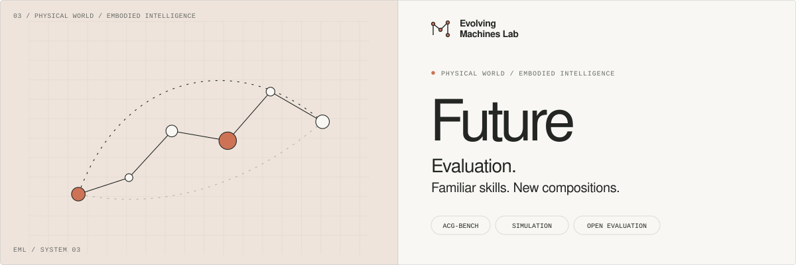

[](https://zhangzaibin.github.io/evolving-machines/)

<p align="center">
  <strong>Evaluate how robot arms compose familiar skills in unfamiliar ways.</strong>
</p>
<p align="center">
  <a href="https://github.com/zhangzaibin/future-robots"></a>
  <a href="https://arxiv.org/abs/2608.25864"></a>
  <a href="https://arxiv.org/abs/2610.06184"></a>
  <a href="LICENSE"></a>
</p>
<p align="center">
  <a href="https://zhangzaibin.github.io/evolving-machines/"><strong>Evolving Machines Lab</strong></a>
  &nbsp; · &nbsp;
  <a href="https://zhangzaibin.github.io/evolving-machines/research/arm-wise-cg/">▶ Film &amp; blog</a>
  &nbsp; · &nbsp;
  <a href="docs/README.md">Documentation</a>
</p>

**Future / Evaluation** is the simulation evaluation companion to [Future Robots](https://github.com/zhangzaibin/future-robots). Built on [RoboFactory](https://github.com/MARS-EAI/RoboFactory) and [ManiSkill](https://github.com/mani-skill/ManiSkill), it provides dual-arm environments, per-arm atomic instructions, rule-based phase transitions, rollout clients, and success / subtask-progress metrics for **MA-VLA** and **ACG-Bench / AE-VLA** research.

Use Future Robots to train and serve a policy; use this repository to execute it in simulation and inspect its coordination behavior. The internal names `RoboFactory` and `MACG` are retained for compatibility with existing experiments. This release comes from the `mas-vla` evaluation codebase.

<p align="center">
  <a href="#quick-start">Quick start</a> &nbsp; / &nbsp;
  <a href="#evaluation">Evaluation</a> &nbsp; / &nbsp;
  <a href="#results">Results</a> &nbsp; / &nbsp;
  <a href="#documentation">Docs</a> &nbsp; / &nbsp;
  <a href="#citation">Cite</a>
</p>

## Research

| Work | Role in the Future ecosystem |
| --- | --- |
| [**MA-VLA · ECCV 2026**](https://arxiv.org/abs/2608.25864) | Multi-arm collaboration through atomic action assignment and arm shuffling |
| [**ACG-Bench / AE-VLA · arXiv 2026**](https://arxiv.org/abs/2610.06184) | Arm-wise composition; arm-token grouping, SkillLoRA, and arm-wise attention |
| [**Future Robots**](https://github.com/zhangzaibin/future-robots) | Training recipes, public datasets, released checkpoints, and HTTP model serving |
| **This repository** | Simulator rollouts, physical / order / timing checks, per-arm serving proxy, and progress logs |

## Quick start

### 1. Install the simulator

Use **Linux with an NVIDIA GPU and Vulkan support**. The simulator's Python environment is separate from Future Robots' model-server environment.

```bash
git clone https://github.com/zhangzaibin/future-robots-eval.git
cd future-robots-eval
conda create -n future-robots-eval python=3.9 -y
conda activate future-robots-eval
python -m pip install -r RoboFactory/requirements.txt
python RoboFactory/script/download_assets.py
```

The asset downloader places files in `RoboFactory/assets/`. Follow the [installation guide](docs/installation.md) for GPU / headless dependencies, a simulation smoke check, and troubleshooting. The model weights and training dataset are downloaded separately in Future Robots; the training dataset is not required for simulator evaluation.

### 2. Start a compatible policy server

In your **Future Robots checkout and its own environment**, download a released checkpoint and start its HTTP server. For example, after following that repository's [checkpoint download instructions](https://github.com/zhangzaibin/future-robots#quick-start):

```bash
# Run in future-robots, using its uv environment.
CHECKPOINT_DIR=checkpoints/AE-VLA-full/aevla_pi05_skill_lora_two_arms_multitask/29999 \
  PORT=20011 bash scripts/serve_recipe.sh aevla_pi05_skill_lora_two_arms_multitask
```

Use the matching configuration for MA-VLA or a baseline. The checkpoint step directory must contain `params/` and `assets/`. Check that the server is ready from the simulator machine:

```bash
curl --fail http://127.0.0.1:20011/health
```

The evaluation client uses **HTTP `POST /infer` with a pickled observation and a pickled action response**. A WebSocket server is a different interface. Use trusted local servers or an SSH tunnel: this protocol deserializes Python objects. See [server compatibility](docs/evaluation.md) for the observation / action contract and separate-arm setup.

### 3. Preview and run evaluation

Back in this checkout with the `future-robots-eval` environment active:

```bash
# Inspect the available tasks and the exact command without launching simulation.
bash scripts/evaluate.sh --list-tasks
bash scripts/evaluate.sh --task stack_cubes \
  --server-url http://127.0.0.1:20011 --dry-run

# Run the clean task conditions for cube stacking.
bash scripts/evaluate.sh --task stack_cubes \
  --server-url http://127.0.0.1:20011

# Run the full configured clean suite.
bash scripts/evaluate.sh --server-url http://127.0.0.1:20011
```

The full convenience suite runs **26 task–condition pairs / 2,600 episodes**, with **100 seeds (1000–1099) per condition**. Start with a [single-rollout smoke check](docs/evaluation.md) before a full batch. The [evaluation guide](docs/evaluation.md) covers raw Python flags, phase configurations, task statuses, output naming, and the exact scope of these scripts.

## Evaluation

The [ACG-Bench paper](https://arxiv.org/abs/2610.06184) defines **23 task–condition pairs across eight task families**, including six in-domain conditions and 17 unseen compositions. All methods receive the same per-arm atomic prompts. Success requires the task goal, physical milestones, and the specified order or timing constraints.

| Composition | What changes? |
| --- | --- |
| **Reorder** | Which arm completes a designated event first |
| **Sync** | Which designated events must finish together |
| **Sync + Reorder** | Event timing and order jointly |
| **Cross-task** | Which atomic skills from different tasks are combined |

**The current convenience suite is broader than the paper's eight-family protocol.** It includes nine task families, with bowl stacking as an additional experiment. Its scripts are executable experiment configurations; they do not constitute a frozen paper split manifest. Select and record the exact task–condition set when comparing against published results. See the [condition table and reporting requirements](docs/evaluation.md).

<details>
<summary><strong>Independent policies for each arm</strong></summary>

<br>

Start two compatible single-arm HTTP servers, then run:

```bash
bash scripts/evaluate.sh --mode per-arm --task stack_cubes \
  --arm0-url http://127.0.0.1:20011 \
  --arm1-url http://127.0.0.1:20012
```

The launcher starts a local proxy, routes each arm's observation and instruction to its own server, and concatenates returned actions in physical arm order. Each server must return a compatible action chunk with **eight values per arm**, matching horizons, and at least 50 steps. Proxy startup, upstream health checks, and cleanup are automatic. See the [proxy reference](RoboFactory/script/MACG/eval_scripts_rule_base_peram/README.md).

</details>

## Results

Rollouts write artifacts under `RoboFactory/`:

| Output | Contents |
| --- | --- |
| `eval_results_*.log` | Batch arguments, per-seed outcomes, success totals |
| `eval_results_*_episodes.jsonl` | Per-episode success, subtask completion, and normalized progress |
| `eval_results_*_summary.json` | Batch progress summary |
| `eval_video/` | Recorded rollout videos, grouped by task / condition |

Keep results from each model in a separate archive before another run. Aggregate selected episode files with:

```bash
python RoboFactory/script/MACG/eval_common/aggregate_progress.py \
  RoboFactory/eval_results_*_episodes.jsonl \
  --output results/summary.json
```

The aggregator groups by task and condition. Use only files from the same evaluation protocol and checkpoint; combining repeated runs changes their weighting. Its normalized progress score is an additional diagnostic; the paper's full-task success metric remains distinct. Details are in the [results guide](docs/evaluation.md).

## Documentation

| Workflow | Guide |
| --- | --- |
| **Environment** | [Installation, assets, and headless simulation](docs/installation.md) |
| **Rollouts** | [Tasks, servers, conditions, results, and reproducibility](docs/evaluation.md) |
| **Code** | [Repository map and extension points](docs/architecture.md) |
| **Perturbations** | [Recording and replaying visual changes](RoboFactory/script/MACG/eval_scripts_rule_base/REPRODUCIBILITY.md) |
| **Contribute** | [Development and validation](CONTRIBUTING.md) · [Security reporting](SECURITY.md) |
| **Release** | [Publishing a clean source snapshot](docs/publishing.md) · [Third-party notices](THIRD_PARTY_NOTICES.md) |
| **Upstream & experimental workflows** | [Original RoboFactory guide](README-RF.md) · [Data augmentation](DataAugmentation/README.md) |

Legacy policy training, multi-robot experiments, and augmentation tools are retained as research references. The supported entry point for this release is the rule-based dual-arm evaluation workflow above; environment requirements for optional experiments may differ.

## Citation

If you use Future, its models, data, or benchmark in your research, please cite the relevant papers. These entries match the [Future Robots repository](https://github.com/zhangzaibin/future-robots#citation).

```bibtex
@inproceedings{zhang2026ma,
  title={MA-VLA: Multi-arm Vision-Language-Action Model for Collaboration and Compositional Generalization},
  author={Zhang, Zaibin and Xiao, Junlan and Zhang, Zhongbo and Wang, Yifan and Kang, Li and Qin, Yiran and Xia, Changxing and Zhou, Heng and Fu, Talas and Zhou, Enshen and others},
  booktitle={European Conference on Computer Vision},
  pages={399--417},
  year={2026},
  organization={Springer}
}

@article{zhang2026arm,
  title={Arm-wise Compositional Generalization in Dual-Arm Vision-Language-Action Models},
  author={Zhang, Zaibin and Ran, Binghao and Wu, Yuhan and Zhang, Zhongbo and Wang, Yifan and Jiang, Junwei and Xiao, Junlan and Shi, Wangcheng and Kang, Li and Qin, Yiran and others},
  journal={arXiv preprint arXiv:2610.06184},
  year={2026}
}
```

## Acknowledgments and license

This work builds on [RoboFactory](https://github.com/MARS-EAI/RoboFactory), [ManiSkill](https://github.com/mani-skill/ManiSkill), [Diffusion Policy](https://github.com/real-stanford/diffusion_policy), [RoboCasa](https://github.com/robocasa/robocasa), and the open robotics community. Please also cite [RoboFactory](README-RF.md#-bibtex) when using its simulation framework.

The repository retains its [MIT license](LICENSE) and the original MARS-EAI attribution. Third-party components retain their own licenses; see [notices and bundled license texts](THIRD_PARTY_NOTICES.md). Downloaded assets, external datasets, and pretrained weights retain their respective terms. The companion Future Robots repository has its own license.

---

<p align="center">
  <strong>Build what evolves.</strong><br>
  <a href="https://zhangzaibin.github.io/evolving-machines/">Evolving Machines Lab</a> · Digital intelligence × Embodied intelligence<br>
  <a href="https://zhangzaibin.github.io/evolving-machines/">Research &amp; projects</a> · <a href="mailto:dlutzzb@gmail.com">Contact</a>
</p>
